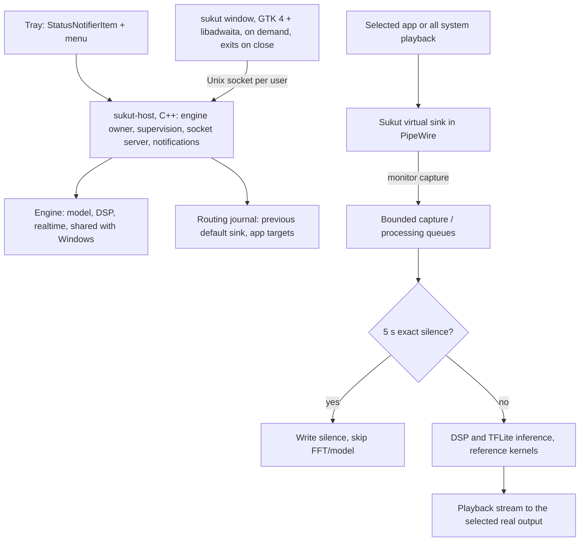

# Sukut for Linux — plan, Debian first

Plan dated 28 October 2026. **Progress (29 October 2026):**

- Stage 0 is done: Debian 13 in WSL 2.
- Stage 1 is done and accepted by the owner: all verifiers pass, DSP audio is byte-identical to Windows, and the model's recurrent step matches TFLite's reference interpreter.
- Stage 8 (the Debian package) is done and accepted by the owner (30 October). Next is stage 9, which needs Debian 13 with GNOME on a real PC or VM. `sukut_0.4.0~beta.1-1_amd64.deb` builds offline and hardened, with no debug data. 10 of 10 package checks pass, including lintian with no errors or warnings, desktop and AppStream validation. 9 of 9 install-cycle checks pass: install, the installed window and engine, upgrade, remove, purge. Owner decisions on 29 October: Sukut's own code is "all rights reserved", and the sealed model is proprietary data that ships with Sukut (its source is never named).
- Stage 7 (phone tools) is done and accepted by the owner. The Phone page and `PhoneTools` port the Windows flows using Debian's `adb` and the same signed APK and activation script. 24 of 24 checks pass against a stand-in phone, plus 13 screenshots and the keyboard check. The live check on the owner's phone moves to stage 9 on real Debian (owner decision: WSL can't see USB without usbipd-win).
- Stage 6 is done and accepted by the owner after reviewing the screenshots; Orca and real-desktop checks move to stage 9. The GNOME-native window (section 7, owner's decision) is built: sidebar, Audio with the Playback card, Settings with About, the help dialog and the four-step setup, in English and Arabic, light, dark and high contrast. 30 screenshots and 4 keyboard checks pass, plus 10 of 10 checks of the real window with the real host. Stage 5 still passes. Orca and real-desktop checks need hardware.
- Stage 5 is done and accepted by the owner; real panels and RealtimeKit move to stage 9. `sukut-host` owns the engine, the tray and the window's socket. 55 of 55 checks pass on a private session bus, with stand-ins for the panel's tray watcher and the notification server: the full tray menu, On, modes, buffering and source app from the menu, Standby, the closed-app rule, Arabic, the window opening and closing to the tray with the notification, the no-tray fallback, single instance, autostart, a panel restart, and Exit, SIGTERM and crash restore. Real panels (GNOME with and without the extension, Plasma 6) and RealtimeKit being granted need a real desktop session. Stage 4 still passes. Stage 3 passed on its second re-run; the first had one missed deadline in Optimized (4 underruns) at normal priority, which stage 9 must measure on hardware.
- Stage 4 is done and accepted by the owner. 28 of 28 routing checks pass, verified in the PipeWire graph: one-app routing and the app-closed rule, following an output the user picks, output removal and reappearance, and crash restore in both modes.
- Stage 3 is done and accepted by the owner. The shared engine runs live between PipeWire capture and playback, with the same settings as the Windows host. 20 of 20 checks pass in all three modes:
  - the live output equals an offline replay bit for bit;
  - the output device receives it exactly;
  - no gaps, and Standby works.

  Music is reduced by 41–60 dB and speech is unchanged (synthetic music). Listening on real music is still to do.
- Stage 2 is done and accepted by the owner. It ran in WSL, which runs PipeWire 1.4.2 and WirePlumber 0.5.8. 21 of 21 checks pass:
  - sample-exact audio, confirmed pre-volume capture and mirrored volume and mute (section 5.3 confirmed);
  - no gaps;
  - the default restored after Off, after a crash, and without undoing a newer choice.

  Listening on real hardware is still to do.
- See [README.md](README.md) and the summaries for [stage 1](evidence/stage1-2026-10-29/SUMMARY.md), [stage 2](evidence/stage2-2026-10-29/SUMMARY.md), [stage 3](evidence/stage3-2026-10-29/SUMMARY.md), [stage 4](evidence/stage4-2026-10-29/SUMMARY.md), [stage 5](evidence/stage5-2026-10-29/SUMMARY.md), [stage 6](evidence/stage6-2026-10-29/SUMMARY.md), [stage 7](evidence/stage7-2026-10-29/SUMMARY.md) and [stage 8](evidence/stage8-2026-10-29/SUMMARY.md). This replaces the historical GNOME/Flatpak starter kit, whose folder (`C:\Users\osama\Documents\CoS - BACKUP\Linux`) is no longer on this PC.

First target: **Debian 13 "trixie" (current stable), amd64, GNOME on Wayland**. KDE Plasma is the second desktop to check. Flatpak, arm64 and Ubuntu come after the Debian package works.

The reference is **Windows 0.4.0-beta.13**: its source in `Windows/src` and its record in [WINDOWS-beta13.md](../docs/beta-0.4/WINDOWS-beta13.md). Linux matches its look, behaviour, icon and sealed engine assets, using Linux equivalents for everything Windows-specific.

## 1. Rules carried over

- The owner confirms each stage (section 12) before the next one starts.
- Audio quality comes first. Do not change the model, DSP, gains, presets, buffering levels or Standby rule.
- Public wording is "Sukut's separation model". Do not name its source in code, packages, metadata or docs.
- Only the **sealed** engine files ship. Plain copies never enter the repo, the source package or a binary package.
- Make no RAM, CPU, battery or latency claim until it is measured on Linux.
- Off, Exit and crashes must give the user back the audio setup they had.
- Nothing is published (GitHub release, APT repository, Flathub) without the owner's instruction.

## 2. Debian 13 facts this plan relies on

Checked on packages.debian.org on 28 October 2026.

| Package | Version in trixie | Use |
|---|---|---|
| `pipewire` | 1.4.2-1 | Audio server (Debian GNOME default) |
| `wireplumber` | 0.5.8-2 | Session manager: default devices, stream targets |
| `libpipewire-0.3-dev` / `libpipewire-0.3-0t64` | 1.4.2-1 | Build / runtime library |
| `libgtk-4-1` | 4.18.6+ds-2 | Window toolkit |
| `libadwaita-1-0` | 1.7.6-1~deb13u1 | GNOME widgets: breakpoints, dialogs, navigation |
| `cmake` | 3.31.6-2 | Build |
| `g++` | 4:14.2.0-1 (GCC 14) | Compiler |
| `gnome-shell-extension-appindicator` | 59-4 | Tray icons on GNOME (not enabled by default) |
| `adb` | 1:34.0.5-12 | Phone tools; depends on `android-udev-rules` |
| `fonts-ibm-plex` | trixie | Includes IBM Plex Sans Arabic (`/usr/share/fonts/truetype/ibm-plex/`) |

Readex Pro and Handjet are **not** packaged in trixie, so Sukut ships them itself (section 10).

## 3. Architecture

The Windows split stays: a small always-running host owns the engine and the tray, and the full window is a separate process that starts on demand and exits when closed.

| Windows beta.13 | Linux |
|---|---|
| `Sukut.exe` native host (Win32) | `sukut-host` (C++20, GLib/GIO for D-Bus, PipeWire thread loop, **no GTK**) |
| `SukutWindow.exe` (WinUI 3) | `sukut` (C++, GTK 4.18 + libadwaita 1.7), started on demand, exits when closed |
| Named pipe `\\.\pipe\Sukut.Host.<session>`, message mode, remote clients rejected | `$XDG_RUNTIME_DIR/sukut/host.socket`, `SOCK_SEQPACKET` (keeps message boundaries), directory mode 0700, same-UID check with `SO_PEERCRED`. Same verbs: `hello`, `read`, `apps`, `select`, `refresh`, `amp`, `exit`, plus `open` |
| Mutex `Local\SukutHost` and the `Sukut.ShowWindow` message | `flock` on `$XDG_RUNTIME_DIR/sukut/host.lock`; a second launch sends `open` over the socket |
| VB-CABLE + WASAPI capture/render | PipeWire: Sukut's own virtual sink, a monitor capture stream and a playback stream. **No driver to install** |
| Default endpoint switching, per-app routing, `SukutVolumeGuard` | WirePlumber metadata `default.configured.audio.sink` and per-stream `target.object`, a journal, and restore on start, Off and Exit |
| MMCSS "Pro Audio" (`ProcessingThreadTask.cpp`) | RealtimeKit (`org.freedesktop.RealtimeKit1`) for the processing thread, with normal priority as fallback |
| `IsProcessorFeaturePresent` (AVX/AVX2 runtime guard) | `__builtin_cpu_supports` |
| `Shell_NotifyIcon` + Direct2D flyout | StatusNotifierItem + `com.canonical.dbusmenu` menu. No custom flyout: Wayland can't place a window next to the tray |
| Balloon notification (`NIF_INFO`) | `org.freedesktop.Notifications` |
| `HeapCompact` + `SetProcessWorkingSetSize` trims | `malloc_trim(0)` after window or menu work, only while Off |
| `runtime/sukut-ui.json` | `$XDG_CONFIG_HOME/sukut/settings.json` (same keys; section 7); journal and health in `$XDG_STATE_HOME/sukut/` |
| Pinned Google platform-tools download | Debian `adb` package, no download |
| `Assets/Sukut.ico`, `Tray-*.ico` | hicolor PNG app icons and SVG tray icons (section 9) |

## 4. Engine and the sealed model

### 4.1 What ports as is

| Windows module | Size | Windows-only code |
|---|---|---|
| `src/dsp` | 7 files, 585 lines | none |
| `src/model` | 3 files, 484 lines | `SeparationModel.cpp` includes `windows.h` only for the AVX/AVX2 runtime guard |
| `src/model/AssetSeal.h` | header only | none (C++17, `std::filesystem`, explicit little-endian) |
| `src/realtime` | 10 files, 1,078 lines | `ProcessingThreadTask.cpp` (MMCSS) |
| `src/audio`, `src/live`, `src/sukut` | WASAPI, Core Audio routing | replaced by the PipeWire layer (section 5) |

Engine constants that stay exactly as they are:

- 48 kHz, stereo, int16 in;
- FFT 1536, hop 960 frames (20 ms), overlap 576;
- one inference thread with a 20 ms budget;
- Standby after 250 packets (5 s) of exact digital silence, with the recurrent state held and a one-LSB resume.

**Reuse, don't copy.** `Linux/CMakeLists.txt` builds the same `Windows/src/{dsp,model,realtime}` files and verifiers. The only Linux changes in shared code are:

- a POSIX branch in `realtime/ProcessingThreadTask.cpp`;
- a standard `main` beside `wmain` in three verifiers.

The AVX guard in `SeparationModel.cpp` is unused on Linux, because the Linux build uses the `Baseline` runtime. Moving the shared engine to a common `engine/` folder is still possible later (section 13), done once for both platforms.

### 4.2 Sealed assets

The three files are `separator.tflite`, `window_576_q15.bin` and `window_960_q15.bin`. Full background is in [MODEL-ASSETS.md](../docs/beta-0.4/MODEL-ASSETS.md).

- **Same files, byte for byte.** The package takes the sealed copies from `Windows/assets/engine/`. A packaging check compares their SHA-256 with the Windows and Android (`app/src/engine/assets/`) copies and fails on any difference. No re-sealing for Linux.
- **Format.** A 16-byte random nonce, then the original bytes XORed with a xoshiro256\*\* keystream. The keystream is seeded through SplitMix64 from the built-in 256-bit key and the nonce. Words are little-endian. Sealed files contain no `TFL3` header, tensor names or recognisable weights.
- **Loader.** Linux uses `Windows/src/model/AssetSeal.h` itself: `seal::ReadFile()` reads each file into one heap buffer and opens it in place once at start. There must never be a fourth implementation. The Python tool (`tools/seal-assets.py`), the Kotlin loader (`AssetSeal.kt`) and this header stay identical, key included.
- **Cost, as on Windows.** About 2.5 MB of private memory for the opened model, and one XOR pass at engine start. Inference is unchanged.
- **Neutral names.** Tensors are `t<index>` and the conversion metadata is empty. The engine uses tensor indices only, so this changes nothing.
- **Install path.** `/usr/share/sukut/engine/`, mode 0644, owned by root.
- **Key handling.**
  - The key lives only in `AssetSeal.h`. It never goes into docs, logs, `debian/` files or test fixtures.
  - Shipped binaries are stripped.
  - The automatic `-dbgsym` package is built but **not published**, because its symbols would label the key constants.
- **Plain copies.** These stay only in `D:\Sukut-Dev\private-model\`. If a parity check needs them on the Linux machine, they are deleted after the check.
- **Limit.** This stops extract-and-compare checks; it is not tamper-proof encryption. A skilled reverse engineer could recover the key from any platform's binary.

### 4.3 TFLite build

- Pinned TensorFlow **2.16.1** TFLite C API and KissFFT **131.1.0**, from the same archives and SHA-256 values as `Windows/deps/DEPENDENCIES.lock.md`. FXdiv uses the same commit pin.
- The same TFLite options as Windows: static link, **XNNPACK OFF, RUY ON**, no delegates, 1 thread, and the `Baseline` CPU runtime.
- Target the x86-64 baseline: no `-march=native` and no SSE4.1. GCC then skips TFLite's NEON_2_SSE code path, as MSVC does on Windows; `TF_LITE_DISABLE_X86_NEON` is also defined to be sure. TFLite's CMake still requires the NEON_2_SSE headers on x86, so `seed-deps.sh` fetches them from TFLite's pinned URL and checks the pinned SHA-256.
- Debian builds must not download anything. Every archive that TFLite's CMake would fetch (abseil, eigen, flatbuffers, gemmlowp, farmhash, fft2d, cpuinfo, pthreadpool and so on) is vendored into the source package with its hash, and the build runs with `FETCHCONTENT_FULLY_DISCONNECTED=ON`.
- Engine sources build with `-ffp-contract=off` on top of Debian's hardening flags, so no fused multiply-adds change results.

### 4.4 Parity (stage 1 gate)

- Run `cleanwave_model_verify`, `cleanwave_dsp_verify` and `sukut_efficiency_verify` on Linux, on the sealed files.
- Compare the 20 reference-vector outputs and 6 DSP outputs with the Windows results.
- The goal is byte-identical. If GCC or libm makes them differ, report the largest relative error per output head and do listening checks. The owner decides whether that is acceptable. Do not loosen anything silently.

## 5. Audio on PipeWire

### 5.1 Nodes Sukut creates

1. **Virtual sink.** The host creates an `adapter` object with `factory.name = support.null-audio-sink` and these properties:
   - `node.name = sukut_sink`, `node.description = Sukut`, `media.class = Audio/Sink`;
   - `audio.position = [ FL FR ]`, `audio.rate = 48000`;
   - `object.linger = false`, so the sink disappears if the host dies;
   - `monitor.channel-volumes = false`, so the capture is taken before volume.
2. **Capture stream.** A `pw_stream` with `stream.capture.sink = true`, `target.object = sukut_sink`, S16LE stereo at 48 kHz and `node.dont-reconnect = true`.
3. **Playback stream.** `target.object = <node.name of the chosen output>` and `node.dont-reconnect = true`.

Output and app lists leave out Sukut's own nodes, which prevents feedback.

### 5.2 Routing

- **All system audio.** Write the current `default.configured.audio.sink` to the journal, then set it to `sukut_sink`. WirePlumber 0.5 moves streams that follow the default. On Off or Exit, restore the journal value.
- **One source app.** Point that app's stream nodes at `sukut_sink` with `target.object` metadata (`Spa:Id`, the sink's `object.serial`). Watch the registry for new streams from the same app. Off clears the metadata.
  - *As built in stage 4:* the process id is read from the stream's client (`pipewire.sec.pid`, falling back to `application.process.id`), because PipeWire doesn't put it on the stream node.
  - If the app closes, use the same rule as Windows: stop, keep Sukut off, and show "Source app closed. Select a mode for all system audio, or choose another Source app in Settings."
- **Default output changed by the user** (GNOME Settings, while Sukut is on). Treat it as a new output, like Windows `DefaultOutputChanges`:
  - move the playback stream to that device;
  - set the default back to `sukut_sink`;
  - save the choice.

  Ignore Sukut's own metadata writes (by sequence number) so this can't loop.
- **Output removed** (headphones unplugged). Follow WirePlumber's next default real sink, as the Windows host does.
- **Bluetooth.** PipeWire Bluetooth sinks are ordinary sinks. Test A2DP latency and keep the same buffering advice as Windows.

### 5.3 Volume

The model must see full-level input, as on Windows with VB-CABLE's volume control off. The capture is therefore before volume. The Sukut sink's `channelVolumes` and mute are mirrored onto the playback stream with `pw_stream_set_control`, so volume keys and the GNOME volume slider still work.

**Confirmed in stage 2 (29 October 2026):** with the sink at 0.125, the output gain is exactly 0.1250. A capture after volume would give 0.0156.

### 5.4 Threads and timing

- The PipeWire `process` callbacks only copy into and out of the existing bounded queues (`FixedQueue`, `BufferedAudioPipeline`). They never block and never run the model.
- Inference runs on the processing thread. That thread asks RealtimeKit for priority and continues at normal priority if refused.
- The streams request `node.latency = 960/48000`, one hop. The Lowest, Balanced and Maximum buffering choices are unchanged.
- Measure end-to-end latency and xruns in stages 2 and 3. Claim nothing before that.

### 5.5 Crash safety

- `object.linger = false` makes the sink disappear with the host, and apps fall back to a real sink on their own.
- The journal (`$XDG_STATE_HOME/sukut/routing.json`) is applied on the next host start and on Exit. It restores the configured default **only if it still names `sukut_sink`**, so a newer user choice is never undone. This is the same ownership rule as Windows.
- A manual repair command exists: `sukut --restore-audio`.

### 5.6 Not supported

PulseAudio-only systems: Debian 13 GNOME uses PipeWire by default. The setup guide checks for PipeWire and WirePlumber and explains clearly if either is missing.

## 6. Host: `sukut-host`

- Ports the logic of `Windows/src/sukut-host/main.cpp`:
  - supervision while no window is connected (2.5 s);
  - restart policy: 3 attempts at 1, 2 and 4 s, reset after a minute healthy;
  - the closed-source-app rule and attention text;
  - versioned settings shared with the window;
  - the device and app catalog.
- **Tray.** A StatusNotifierItem registered with `org.kde.StatusNotifierWatcher`:
  - `Id = io.github.altarafiya.Sukut`, `Category = ApplicationStatus`;
  - tooltip `سُكوت Sukut · <status>`;
  - `IconName` changes between on and off (section 9).
- **Left click (`Activate`).** Opens the window, or brings it forward if it is already open. Where the panel supports `ProvideXdgActivationToken`, the token is passed so Wayland lets the window take focus.
- **Menu (DBusMenu).** It mirrors the Windows flyout:

  | Item | Kind |
  |---|---|
  | Status line, e.g. "Standby · nothing playing" with a sleeping-face icon | disabled label |
  | **Sukut on** (the On/Off switch) | checkbox |
  | Music Filter, Optimized, Strict | radio |
  | Audio buffering ▸ Lowest, Balanced, Maximum | radio submenu |
  | Audio output ▸ devices | radio submenu |
  | Source app ▸ All system audio, then apps | radio submenu, refreshed on `AboutToShow` |
  | Open Sukut, then Exit | actions |

  While the window is open, the menu shrinks to **Open Sukut** and **Exit**, as on Windows, where the tray only brings the window forward then.

  Labels follow the Sukut language. *As built in stage 5:* the menu's `TextDirection` property is `rtl` in Arabic; whether each panel honours it is checked on real desktops.
- **No tray available.** Stock GNOME has no StatusNotifierWatcher until the "AppIndicator and KStatusNotifierItem Support" extension is enabled. The host watches for the watcher:
  - Without it, **Close to tray** is turned off and greyed out. Its explanation says to install and enable the extension (`gnome-shell-extension-appindicator`, then the Extensions app).
  - Closing the window then exits Sukut and restores audio.
  - *As built in stage 5:* a host started with `--tray` (autostart) opens the window after 5 s if no tray has appeared, so Sukut never runs invisibly.
- **Socket protocol as built (stage 5).** The host is the only writer of `settings.json`: the window sends `settings KEY=VALUE…` (Language, Theme, CloseToTray, SetupCompleted, StartWithSystem) instead of writing the file. `select` takes `MODE OUTPUT PID BUFFERING BG_DB`; the Windows VB-CABLE fields are gone. `read` also reports the route the running session uses. The full table is in the [stage 5 summary](evidence/stage5-2026-10-29/SUMMARY.md).
- **Notification on close to tray.** `Notify` with app name "Sukut", icon `io.github.altarafiya.Sukut` and hint `desktop-entry = io.github.altarafiya.Sukut`. It uses the same English and Arabic texts as Windows: "Sukut is in the tray / The window closed to save memory…". The number in "under N MB" is filled in only after stage 9 measures the Linux host.
- **Memory.** `malloc_trim(0)` after the window disconnects and after menu use, only while Off.
- **Start with system.** An optional setting writes `~/.config/autostart/io.github.altarafiya.Sukut.desktop` with `Exec=sukut --tray`. The package never enables it.
- **Exit.** Restores routing (section 5.5), removes Sukut's nodes, deletes the socket and quits. On `SIGTERM` (logout or shutdown) it does the same.

## 7. Window: `sukut`, GNOME-native

Built with GTK 4.18 and libadwaita 1.7 through their C API from C++.

**Owner decision, 29 October 2026.** Windows moved to beta.14 ([WINDOWS-beta14.md](../docs/beta-0.4/WINDOWS-beta14.md)) after this plan was first written: a native navigation sidebar, a compact Start/Stop button and full-width mode rows, replacing beta.13's phone-like look. Linux follows that idea **the GNOME way**, with libadwaita's own widgets, instead of copying either Windows layout. Sukut's palette, mode colours, mode help, Standby face, fonts and About stay.

### Layout

- `AdwApplicationWindow` with application ID `io.github.altarafiya.Sukut`, so a second launch raises the open window. Default size 1040 × 720 (beta.14), minimum 420 × 480.
- **`AdwNavigationSplitView`:** a sidebar with **Audio** and **Phone**, and **Settings** at its bottom, like the Windows NavigationView. Below 600 sp the sidebar collapses into a page with a Back button (Esc, Alt+Left), as GNOME Settings does. In Arabic the whole window mirrors.
- **Audio page.** The header bar shows "Audio" with the subtitle "Output, source and filtering". Below 900 sp of window width the Playback card moves under the modes (`AdwBreakpoint` setting the box's orientation).
  - **Status card:** the status (Off, On, Standby, Starting…, Reconnecting, Attention) in 20 px semibold, the mode name or the Standby text under it, and a **Start/Stop** button with the power icon. The looks match beta.14:
    - Off: accent container with a 1.5 px accent outline;
    - On: solid accent;
    - Standby: solid accent, with the sleeping face beside the status and the text "Nothing is playing. Sukut rests to save power and wakes as soon as sound starts.";
    - Attention: amber.
  - **Problems** (source app closed, audio stopped) appear in an `AdwBanner` with "Restart audio" where that helps.
  - **"Audio mode"** with a **?** button, then the three modes as rows in a boxed list: coloured icon, name, short description and a radio check. As on Windows beta.14, **choosing a mode while Off does not start filtering**; Start does. While on, a new mode switches live. The Music Filter icon is the Windows path, always drawn left-to-right.
  - **Background level** (Optimized only): −20 to +10 dB, committed on release.
- **Playback card** (360 px when beside the modes):
  - **Audio output:** a boxed list with one radio choice per real output;
  - **Source app:** "All system audio", then the playing apps with their icons, a refresh button, and "Open an app, then refresh to add it here.";
  - **Audio buffering:** three linked buttons (Lowest, Balanced, Maximum) in violet, amber and rose, with "Higher buffering reduces interruptions and adds audio delay."

  The lists refresh when the window becomes active and from the refresh button.
- **Settings page:** an `AdwPreferencesPage` in the content area (sections below).
- **Phone page** (stage 7): in the sidebar between Audio and Settings; see "Phone page" below.

### Mode help

The **?** button opens an `AdwDialog` titled "Audio help / دليل الصوت" with a Done / تم button. It has two sections side by side when wide, with the same texts as `ModeHelp.cs` and `BufferingHelp.cs`:

- **Audio modes:** Music Filter (violet), Optimized (amber), Strict (rose), and Start and stop (accent);
- **Audio buffering:** what buffering does, the three levels, and audio delay and video sync.

Each card has its colour, icon and bullet points.

### Settings, in this order

1. **General:**
   - Language (English / العربية, always written that way);
   - App theme (System / Light / Dark, via `AdwStyleManager`);
   - **Close to tray** (switch, with "Closing the window keeps Sukut in the tray."). Without a tray it is off and greyed out, and says how to get one on GNOME;
   - **Start with system** (switch; writes or removes the autostart entry through the host).
2. **Audio:** amplification, 0–12 dB, with its note.
3. **Shortcuts:** Sound settings (`gnome-control-center sound` on GNOME, `systemsettings kcm_pulseaudio` on Plasma) and the Setup guide. Linux has no VB-CABLE or Dolby shortcuts.
4. **Advanced:** refresh devices, and diagnostics to copy. Linux has no virtual input or capture choice: the sink is internal.
5. **About**, last, like the phone:
   - the 64 px rounded icon, "Sukut · سُكوت", the version, "Developed by";
   - the rainbow الطرفية credit, animated only while the card is on screen (tick callback while mapped and inside the scrolled viewport);
   - the font credits;
   - What's new, with the version as its own left-to-right English run.

### Palette

These go into the app CSS (`@define-color`), with high contrast following `AdwStyleManager`.

| Token | Dark | Light |
|---|---|---|
| Accent / on accent | `#80BFEA` / `#000000` | `#17659B` / `#FFFFFF` |
| Accent container | `#303D45` | `#DEE6EB` |
| Warning / container | `#E3C184` / `#3B3324` | `#805B20` / `#F4ECD9` |
| Music Filter (violet) | `#AAA5FF` | `#5B52C7` |
| Optimized (amber) | `#E7C48E` | `#795315` |
| Strict (rose) | `#F2A7AB` | `#A02C3B` |
| Off | `#ACBBD5` | `#4F607D` |

### Arabic and fonts

- `gtk_widget_set_default_direction(GTK_TEXT_DIR_RTL)` and Pango language `ar`.
- Version numbers and device names are left-to-right runs. Arabic stays joined: no spans may split words.
- Readex Pro, Handjet and IBM Plex Sans Arabic (Regular and SemiBold) ship in `/usr/share/sukut/fonts/` and are loaded only for Sukut (`FcConfigAppFontAddFile`). They are the same files as `Windows/src/sukut-ui/Assets/*.ttf`. *Found in stage 6:* Debian 13 has no IBM Plex font package, so it can't come from apt.

### Settings file

`$XDG_CONFIG_HOME/sukut/settings.json` keeps the Windows key names:

- `Language`, `Theme`, `Output` (now a PipeWire `node.name`);
- `SourcePid`, `PreferredMode`, `Buffering`, `AmplificationDb`, `OptimizedBackgroundDb`;
- `SetupCompleted`, `CloseToTray`, `HostSettingsVersion`.

The Windows-only keys (`Source`, `Capture`, `CableVolumeDisabledConfirmed`, `VolumeGuideDismissed`) are not used.

### Phone page

It has the same flows as Windows: connection card, Full setup, Activate, Install or update, and USB help. It uses `adb` from the Debian package, with no download.

- The bundled APK and the activation script sit in `/usr/share/sukut/android/`, each with a `.sha256`. Both are verified before use.
- Activation follows `PhoneWorkerActivation.cs`:
  1. read the current user;
  2. push the script to `/data/local/tmp/sukut-activate-worker.sh` and run it with the user id;
  3. wait until the worker's status shows `state=READY`, `protocol=1`, the installed version code and a PID.

  Deactivation uses the provider's `deactivate` method.
- USB access comes from `android-udev-rules`, which `adb` pulls in. If the device stays unauthorised, the page explains the `plugdev` group.
- *As built in stage 7:*
  - the package is now `com.altarafiyah.sukut` (Android 0.4, code 54), as in the Windows build;
  - adb runs on a background thread;
  - `sukut --phone devices|inspect|status|install|update|setup|open|activate|deactivate [--serial S]` runs the same actions from a terminal;
  - `$SUKUT_ADB` overrides the adb program, which is how the test uses a stand-in phone.

### First-run setup

It owns the whole window until it finishes, as on Windows, with Back and Next and a step indicator. There is no VB-CABLE or volume step on Linux, so it has four steps:

1. **Welcome:** "Welcome to Sukut", "Enjoy the internet. Without the music.", the language choice and a short overview;
2. **System check:** PipeWire and WirePlumber are running (the host connected), and whether a tray is available, with how to get one on GNOME;
3. **Output:** choose your speakers or headphones, and the buffering;
4. **Ready:** the mode hints, what closing the window does, and the closing prayer text from Windows. Its button is "Open Sukut".

### Memory and accessibility

- The window process exits on close. When minimised it calls `malloc_trim(0)`.
- Every control has an English or Arabic accessible name. Keyboard navigation is complete. Check with Orca.
- Developer screenshots use GTK's own widget snapshot (a `--capture` test option), never a screen capture. In WSL they run on GTK's headless Broadway display (`gtk4-broadwayd`), so no window appears on the desktop.

## 8. Phone and Android

The Linux package bundles the same signed Android APK as the matching Windows build. Its metadata (version code, SHA-256 and signer `c39f9596…`) is checked at packaging time. The private signing key is never on the Linux build machine.

**Owner requirement (31 October 2026): every Android feature must work from the window, and the user must never need the terminal.** The owner reports that activation does not work on real Linux.

Known gaps to fix before stage 9 can pass:

- the adb `no permissions` state is not handled;
- the USB help page shows a terminal command;
- `adb` is only Recommended.

The fix is a polkit-prompted button for USB access, `adb` as a hard dependency, and no terminal text anywhere in the UI. [START_NEW_CHAT_LINUX.md](START_NEW_CHAT_LINUX.md) section 2 has the full plan.

## 9. Icons

- **App icon.** The phone launcher icon (`app/src/main/res/drawable-nodpi/sukut_app_icon.png`, 512 px) with **22.5% rounded corners**, the same treatment as the Windows `Assets/Sukut.png`/`.ico` from `work/windows-phone-design/rounded_icon.ps1`.
  - Installed as hicolor PNGs at 16, 22, 24, 32, 48, 64, 128, 256 and 512 px, named `io.github.altarafiya.Sukut.png`.
  - The PNGs are generated once, reviewed, and committed under `Linux/data/icons/`. The build never regenerates them.
- **Tray icon: the س glyph**, from the path in `Windows/src/sukut-ui/Assets/Tray-*.svg`:
  - `io.github.altarafiya.Sukut-tray-on.svg`: gold `#E8C98A`, while filtering;
  - `io.github.altarafiya.Sukut-tray-idle-symbolic.svg`: symbolic, while Off, in the panel's text colour (KDE's ColorScheme-Text stylesheet; GNOME recolours symbolic icons). Renamed from `-tray-off-symbolic` on 31 October 2026 so no icon cache serves the old dark picture.

  Windows also tints the active tray icon by mode (violet, amber, rose; `ModeAppearance.h`). Stage 5 ships gold and symbolic only; mode tinting stays owner decision 5 (section 13).
- *As built in stage 5:* the three tray SVGs are in `Linux/data/icons/hicolor/scalable/status/`, the layout they install to.
- **Standby icon in the menu:** `io.github.altarafiya.Sukut-standby-symbolic.svg`, the sleeping face from the window's power button.
- The notification icon, desktop file and AppStream metadata all use the app ID.

## 10. Debian package

### Identity and distribution

- Source and binary package `sukut`, Section `sound`, Architecture `amd64`.
- First version: `0.4.0~beta.1-1`. The `~` keeps beta versions sorting before the release.
- **Not for Debian's archive.** The sealed model is a non-free binary blob. The owner distributes the `.deb` (a GitHub release, or later a signed APT repository) when instructed.

### `debian/control`

- **Build-Depends:** `debhelper-compat (= 13)`, `cmake`, `ninja-build`, `g++ (>= 4:14)`, `pkgconf`, `libpipewire-0.3-dev (>= 1.0)`, `libgtk-4-dev (>= 4.18)`, `libadwaita-1-dev (>= 1.7)`, `libglib2.0-dev`, `python3`.
- **Depends:** `${shlibs:Depends}`, `${misc:Depends}`, `pipewire (>= 1.0)`, `wireplumber (>= 0.5)`, `librsvg2-common` (SVG icons; *found in stage 6* that a minimal system lacks it), `adwaita-icon-theme`. No font package: Debian 13 has no IBM Plex package, so all four font files ship with Sukut.
- *Stage 6:* the window uses `AdwToggleGroup`, new in libadwaita 1.7, hence the raised minimums.
- **Recommends:** `gnome-shell-extension-appindicator`, `adb`.

### Files

| Path | Content |
|---|---|
| `/usr/bin/sukut` | Window. Starts the host (for the tray) if none runs; a second launch raises the open window |
| `/usr/libexec/sukut/sukut-host` | Host, with the engine and TFLite linked statically |
| `/usr/share/sukut/engine/` | The three sealed files |
| `/usr/share/sukut/fonts/` | Readex Pro, Handjet and IBM Plex Sans Arabic Regular and SemiBold (OFL-1.1) |
| `/usr/share/sukut/android/` | Signed APK, activation script, and their `.sha256` |
| `/usr/share/applications/io.github.altarafiya.Sukut.desktop` | Launcher (EN and AR names) |
| `/usr/share/metainfo/io.github.altarafiya.Sukut.metainfo.xml` | AppStream for GNOME Software |
| `/usr/share/icons/hicolor/*/apps/` | App and tray icons |
| `/usr/share/doc/sukut/copyright` | DEP-5 licence file |

### `debian/copyright`

- Sukut's own code: the owner's licence.
- TensorFlow Lite and its vendored dependencies: each with its own licence (Apache-2.0, BSD, MIT and so on).
- KissFFT: BSD-3-Clause.
- Fonts: OFL-1.1.
- The engine files: "Sukut's separation model, redistributed with permission". The owner supplies the final wording, and the model's source is not named.

### Build and checks

- `dpkg-buildpackage -us -uc` on a clean Debian 13 system (an sbuild chroot later), fully offline, with `hardening=+all`.
- *As built in stage 8:*
  - `Linux/scripts/build-deb.sh` assembles the tree and runs `dpkg-buildpackage -b`, a binary-only build using `~/sukut-deps`;
  - `dh_dwz` is skipped and no `-dbgsym` package is built, so the package has no debug data at all;
  - `debian/sukut.lintian-overrides` explains each override;
  - the install test uses `--no-install-recommends`, because the AppIndicator recommendation pulls in GNOME Shell.
- `lintian` must be clean apart from justified overrides: vendored static TFLite, and the binary blob under `/usr/share`.
- `desktop-file-validate` and `appstreamcli validate`.
- Install, upgrade, remove and purge on a clean VM.

### Uninstall

- No maintainer scripts touch user sessions; dpkg cannot reach them.
- A running host keeps going until logout, and Exit restores audio. If it is gone, the sink is gone too, and WirePlumber falls back by itself.
- `sukut --restore-audio` is documented for a manual clean-up of the configured default.

## 11. Measurements to take (stage 9)

| Process / state | Values |
|---|---|
| Host, Off, window closed | PSS and USS (from `smaps_rollup`), threads |
| Host, filtering on and in Standby | The same, plus CPU % of one core |
| Window, on Home and minimised | The same |
| End-to-end latency, each buffering choice | Generated test audio, xrun count |

The "under N MB" notification text uses the measured host value. Windows figures are not reused.

## 12. Stages and owner gates

Each stage ends with its evidence and the owner's confirmation.

| # | Stage | Done when |
|---|---|---|
| 0 | Debian 13 amd64 machine or VM (GNOME, Wayland), toolchain, vendored dependency archives | CMake configures offline |
| 1 | Engine without audio: TFLite, KissFFT, DSP, model, sealed loader | Model, DSP and efficiency verifiers pass; output compared with Windows (section 4.4) |
| 2 | PipeWire pass-through without the model: virtual sink, capture, playback, volume mirroring, default switch, journal | Sound passes cleanly; pre-volume capture confirmed; latency and xruns measured; Off restores the old default |
| 3 | Processing in the path: engine, buffering choices, Standby | Music removed on real content (EN/AR speech); Standby after 5 s and instant resume; no clicks |
| 4 | Routing ownership: source app, default-output change, device removal, kill test, Exit | Every case restores or follows correctly; nothing undoes a newer user choice |
| 5 | Host: socket protocol, tray and menu, no-tray fallback, notification, autostart option | GNOME with and without the extension, and Plasma 6, all behave as specified |
| 6 | Window: Home, help, Settings, About, setup; EN/AR; light/dark/high contrast; narrow and wide | Screenshots reviewed by the owner; keyboard and Orca pass |
| 7 | Phone tools with Debian `adb` | Install, update, activate and deactivate work on the owner's phone |
| 8 | Debian package | Offline build; lintian, desktop and AppStream checks; install, upgrade, remove and purge on a clean VM |
| 9 | Validation and measurements | Section 11 table filled in; GNOME Wayland and Xorg, Plasma 6. Also the checks carried from stages 2–7: real speakers and music, real panels and the notification on screen, RealtimeKit granted, Orca and real key presses, and install, update, activate and deactivate on the owner's phone over USB (including `plugdev`) |
| 10 | Later, separately approved | Flatpak (PipeWire and portal access, the model licence on Flathub), arm64, Ubuntu 26.04 LTS |

## 13. Owner decisions needed

When implementation started on 28 October 2026, the defaults below were taken for decisions 1 and 2. Either can still be changed before stage 5.

1. **App ID** `io.github.altarafiya.Sukut` (default in use). It matches the published `altarafiya.github.io/Sukut` site and the Flathub naming rule.
2. **Shared engine folder** (default in use): build from `Windows/src`. The alternative is to move `dsp`, `model` and `realtime` to a common `engine/` folder for both platforms.
3. **Licence wording** for Sukut's code and for the model in `debian/copyright`. *Decided on 29 October 2026:* Sukut's code is all rights reserved; the model is proprietary data that ships with Sukut, not for separate use or redistribution.
4. **Distribution channel** for the `.deb`, when the time comes.
5. **Mode-tinted tray icon** on Linux, or gold and symbolic only.

## 14. Risks

- **Stock GNOME has no tray.** Handled by the fallback in section 6. The setup guide explains the extension.
- **Wayland focus rules** may only highlight the window instead of raising it. Use activation tokens where available.
- **Floating-point parity** across compilers and libm (section 4.4).
- **Pre-volume capture** has to be confirmed on PipeWire 1.4.2 (section 5.3).
- **Apps that pin their own output** don't follow the default. Per-app targeting covers them, and stage 4 tests them.
- **RealtimeKit limits** (`RLIMIT_RTTIME`). The processing thread must keep its 20 ms budget, or fall back without glitches. RealtimeKit's polkit rule grants high priority only inside an active desktop session; in WSL it refuses, and the fallback was confirmed in stage 5.
- **Model licence** keeps the package out of Debian main and needs care for Flathub.

## 15. Where things are

| What | Where |
|---|---|
| Windows reference source | `Windows/src` (host `sukut-host/`, window `sukut-ui/`, engine `dsp/`, `model/`, `realtime/`) |
| Current Windows design record | `docs/beta-0.4/WINDOWS-beta13.md` |
| Sealed assets | `Windows/assets/engine/`, `app/src/engine/assets/`, details in `docs/beta-0.4/MODEL-ASSETS.md` |
| Seal tool | `tools/seal-assets.py` |
| Pinned dependencies | `Windows/deps/DEPENDENCIES.lock.md`, archives in `D:\Sukut-Dev\deps` |
| App icon source and rounded generator | `app/src/main/res/drawable-nodpi/sukut_app_icon.png`, `work/windows-phone-design/rounded_icon.ps1` |
| Tray glyph | `Windows/src/sukut-ui/Assets/Tray-*.svg` |
| Mode help texts | `Windows/src/sukut-ui/ModeHelp.cs` (Android: `app/src/main/res/values*/appearance_help.xml`) |
| Phone activation logic | `Windows/src/sukut-ui/PhoneWorkerActivation.cs`, `PhoneTools.cs` |
