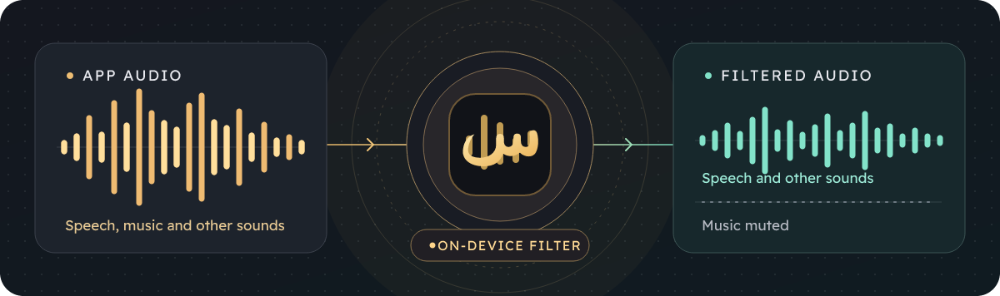

  

<h1 align="center">Sukut · سُكوت</h1>

  <strong>Enjoy the internet. Without the music.</strong> 
  استمتع بالإنترنت، بلا موسيقى.

  <a href="#download"><strong>Download</strong></a> ·
  <a href="#features">Features</a> ·
  <a href="#four-audio-modes">Audio modes</a> ·
  <a href="#get-started">Setup</a>

Sukut filters music from app audio in real time, so you can keep watching and hear the speech you came for.
Available for Windows, Android and Linux (beta).

يُرشّح سُكوت الموسيقى من صوت التطبيقات في الوقت الفعلي، لتتابع المشاهدة وتسمع الكلام بوضوح أكبر. يتوفر على ويندوز وأندرويد ولينكس (تجريبي).

## Features

<table>
  <tr>
    <td width="50%" valign="top">
       
      <strong>Real-time music filtering</strong> 
      Mute music as your apps play and keep speech and other sounds audible in Music Filter mode.
    </td>
    <td width="50%" valign="top">
       
      <strong>Lightweight controls</strong> 
      Keep Sukut in the desktop tray or switch modes from Android’s notification or Quick Settings.
    </td>
  </tr>
  <tr>
    <td width="50%" valign="top">
       
      <strong>Tunable playback performance</strong> 
      Use a shorter buffer for less delay or a longer buffer to help smooth out interruptions.
    </td>
    <td width="50%" valign="top">
       
      <strong>On-device processing</strong> 
      Sukut processes playback locally. Your audio stays on your device.
    </td>
  </tr>
  <tr>
    <td width="50%" valign="top">
       
      <strong>Adjustable background sound</strong> 
      Use the background slider in Optimized mode or choose Strict to focus on speech.
    </td>
    <td width="50%" valign="top">
       
      <strong>App and output selection</strong> 
      On Windows and Linux, choose which app to filter and where to play the audio.
    </td>
  </tr>
</table>

The interface supports English and Arabic, with light, dark and system themes.

## Download

| Platform | Download | Requirements |
| --- | --- | --- |
|  **Windows** | **[Sukut 0.4.2 for Windows (ZIP)](https://github.com/altarafiya/Sukut/releases/download/v0.4.2-linux-beta.7/Sukut-0.4.2-Windows-x64.zip)** | Windows 10/11, x64, [VB-CABLE](https://vb-audio.com/Cable/) |
|  **Android** | **[Sukut 0.4.2 for Android (APK)](https://github.com/altarafiya/Sukut/releases/download/v0.4.2-linux-beta.7/Sukut-0.4.2-Android-arm64.apk)** | Android 10+, ARM64 |
|  **Linux (beta)** | **[Sukut 0.4.0 beta 7 (.deb)](https://github.com/altarafiya/Sukut/releases/download/v0.4.2-linux-beta.7/Sukut-0.4.0-beta.7-Linux-amd64.deb)** | x64, PipeWire. Built on PikaOS 4; a Debian 13 build will follow |

[All releases and checksums →](https://github.com/altarafiya/Sukut/releases)

## Four audio modes

| Mode | What you hear |
| --- | --- |
| **Off** | Original audio; processing stops. |
| **Music Filter** | Music muted; speech and other sounds stay. |
| **Optimized** | Music muted, with a background slider to suit what you are watching. |
| **Strict** | Music and background muted, focusing on speech. |

Results vary when sounds overlap in a recording. Strict can also remove sound effects.

## Get started

**Windows**

1. Install [VB-CABLE](https://vb-audio.com/Cable/) if you don't have it, then restart.
2. Extract the whole ZIP folder and open `Sukut.exe`. Exit an older Sukut in the tray first.
3. Follow the welcome guide, choose your speakers or headphones, and pick a mode.

Bluetooth headphones work too. When a new audio device connects, Sukut switches to it
and shows a notification; turning Sukut off returns Windows sound to that device.
Sukut keeps working in the tray when you close its window. The ZIP is not publisher-signed.

**Android**

1. Install the APK and open Sukut.
2. Follow the setup guide to activate Sukut's audio worker: on Android 11+ through
   Wireless debugging on the phone itself, or over USB from Sukut on Windows or Linux.
3. Choose a mode in the app, its notification or Quick Settings.

The GitHub APK and the Google Play app are signed differently. To switch from one to
the other, uninstall the one you have first.

**Linux (beta)**

1. Open the `.deb` with your software installer, or run
   `sudo apt install ./Sukut-0.4.0-beta.7-Linux-amd64.deb`.
2. Open Sukut from your apps and follow the welcome guide.
3. The Phone page installs and activates the Android app over USB, all from the window.

Sukut switches to newly connected headphones and returns to the previous output when they
disconnect. If you use EasyEffects, follow the [setup steps](Linux/README.md#sukut-with-easyeffects),
also available under Audio output.

## Updates and support

See [what's new](CHANGELOG.md). Found a problem? [Open an issue](https://github.com/altarafiya/Sukut/issues/new/choose)
with your app version, device/output, and the steps that caused it.
Privacy policy: <https://altarafiya.github.io/Sukut/privacy.html>.

Development layout and build guidance are in [AGENTS.md](AGENTS.md).
Model files, sealed engine assets and signing material are not in this repository.
Third-party components retain their [notices and licenses](THIRD_PARTY_NOTICES.md).

<strong>Developed by الطرفية</strong>

