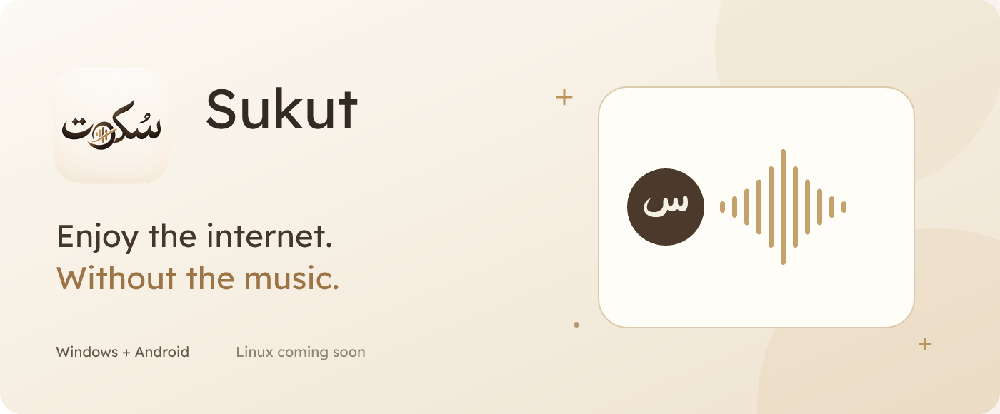

  

<h1 align="center">Sukut · سُكوت</h1>

<strong>Enjoy the internet. Without the music.</strong> استمتع بالإنترنت، بلا موسيقى.

  
  
  

Sukut filters music from audio playing in your apps. Choose a mode, keep watching,
and hear the speech you came for. Audio processing happens on your device.

سُكوت يرشّح الموسيقى من صوت تطبيقاتك. اختر وضعًا، وتابع ما تشاهده بكلام أوضح.
تجري معالجة الصوت على جهازك.

## Download

| Platform | Download | Requirements |
| --- | --- | --- |
| Windows | **[Download Windows installer](https://github.com/altarafiya/Sukut/releases/download/v0.2.33/Sukut-0.2.33-Windows.exe)** | Windows 10/11, x64; setup guides you through VB-CABLE |
| Android | **[Download signed Android APK](https://github.com/altarafiya/Sukut/releases/download/v0.2.33/Sukut-0.3.31-Android.apk)** | Android 10+, ARM64; Shizuku setup is required |
| Linux | Coming soon | Planned for GNOME, distributed as Flatpak |

The Windows installer includes the Android app. Use the **Phone** page to install
it, update it, or follow the full USB setup. [All releases and checksums →](https://github.com/altarafiya/Sukut/releases)

## Four audio modes

| Mode | What you hear |
| --- | --- |
| **Off** | Original audio; processing stops. |
| **Music Filter** | Music muted; speech and other sounds stay. |
| **Optimized** | Music muted, with a background slider to suit what you are watching. |
| **Strict** | Music and background muted, focusing on speech. |

Results depend on the recording: mixed sounds can overlap. Strict can also remove
sound effects. More buffering can help with short interruptions, but adds delay.

## Get started

**Windows**

1. Run the installer. It offers VB-CABLE if the driver is not already installed.
2. Follow the welcome guide and select your speakers or headphones.
3. Choose an audio mode. Use Off to return to original audio through that output.

Sukut keeps working in the tray when you close its window. Use the tray menu to exit.
The current Windows installer is not publisher-signed.

**Android**

1. Install the APK and open Sukut.
2. Follow the Shizuku guide: use Sukut on a PC over USB, or wireless debugging.
3. Grant Sukut Shizuku access, then choose a mode.

Start Shizuku again after rebooting your phone; reinstalling the apps is normally
unnecessary. For Bluetooth, Sukut selects compatible output settings and lets you
adjust them. Device sound effects depend on your phone and output.

## Made for everyday listening

- English and Arabic, with light, dark and system themes.
- Windows source-app selection, physical volume control and phone setup.
- Android tablet layouts, notification controls and a Quick Settings tile.
- Adjustable background sound, amplification and buffering.
- Local processing, with no cloud audio upload.

## Updates and support

See [what’s new](CHANGELOG.md). Found a problem? [Open an issue](https://github.com/altarafiya/Sukut/issues/new/choose)
with your app version, device/output, and the steps that caused it.

Development layout and build guidance are in [AGENTS.md](AGENTS.md).
Third-party components retain their [notices and licenses](THIRD_PARTY_NOTICES.md).

<strong>Developed by الطرفية</strong>

